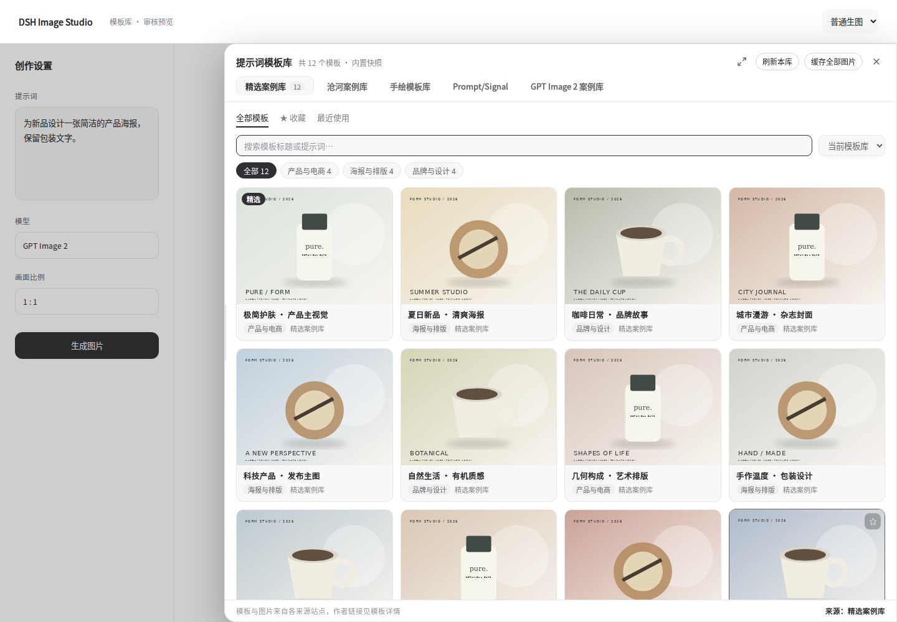
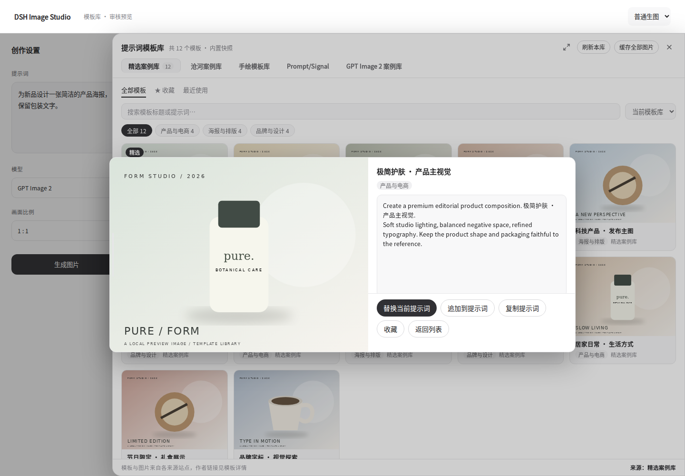
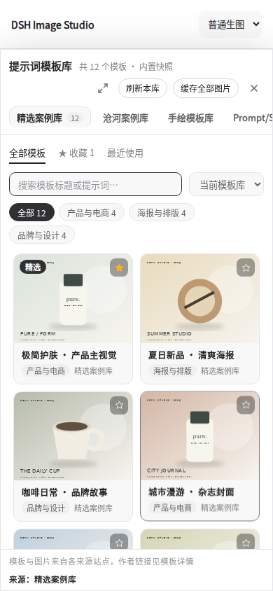
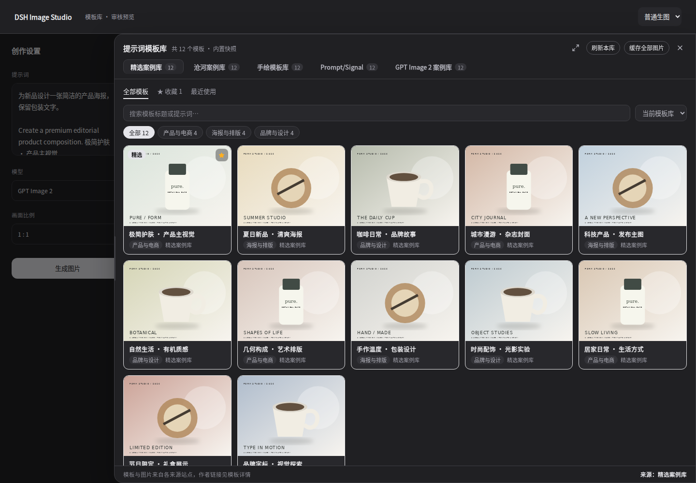

# 模板库大抽屉审核版

状态：开发分支 `feat/template-drawer`，待审核。未合并 main，未发布 GitHub Release 或 npm，package.json 保持 1.7.0。

## 本次更新

- 普通生图、图生图、电商和画布增加统一的悬浮「模板」入口；画布原工具栏入口继续可用。
- 默认占工作区约 75% 的右侧抽屉，支持左边缘拖宽、键盘左右键调宽、宽度记忆及铺满工作区。手机占满可用工作区。
- 保留五个独立来源：精选案例库、沧河案例库、手绘模板库、Prompt/Signal、GPT Image 2 案例库。
- 浏览、收藏、最近使用独立切换；支持当前库搜索或跨库搜索。最近使用最多保留 24 个，存在当前浏览器中；收藏继续使用原有主机存储。
- 详情页可复制、收藏；已有提示词时明确提供「替换」和「追加」。图生图保留原模式及参考图。
- 电商模板追加到参数信息，保留已有要求、商品名称、参考图和出图配置。画布继续创建连接的文本与生成配置节点。
- Escape 先返回列表，再关闭抽屉；恢复入口焦点，抽屉内的键盘输入不触发画布删除、撤销等操作。

## 界面截图

截图使用实际 TemplateLibrary 组件、样式及主机按钮样式。外围工作区、模板数据与图片为本地测试夹具，用于稳定审核交互；正式使用时仍读取项目原有五个模板库及图片代理。

### 桌面



### 详情



### 手机



### 深色



## 验证结果

- `pnpm typecheck`、`pnpm build`。
- `node scripts/smoke.mjs`：80 项通过，包含模板选择、最近使用、跨库搜索、铺满、追加、图生图参考图保留、电商参数及参考图保留、画布快捷键隔离；原有生图、画布、海报编辑等检查继续通过。
- `scripts/template-browser-test.mjs`：真实 Chromium 验证拖宽、重开后宽度记忆、详情返回、焦点恢复、搜索与空结果、收藏、手机适配、来源失败重试，并生成本页截图。
- 本地 tgz 打包与内容校验；没有执行发布。

浏览器验证：

```bash
pnpm exec tsdown --config scripts/template-preview.config.ts
node scripts/template-browser-test.mjs
```

需要本机可用的 Playwright/Chromium；可用 `TEMPLATE_CHROMIUM_PATH` 指定浏览器。`TEMPLATE_PREVIEW_FONT` 可指定用于截图的中文字体文件。测试夹具不会调用生图模型。

## 在自己的 DSH 中审核

```bash
git switch feat/template-drawer
pnpm install --frozen-lockfile
pnpm build
pnpm pack --pack-destination .
dsh plugin --profile web add ./dickpy-dsh-imagegen-1.7.0.tgz
```

这是分支审核构建，版本号仍为 1.7.0，不代表 npm 已更新。安装后重启 `dsh web`，依次体验悬浮入口、五库切换、收藏、最近使用、提示词追加，以及电商与画布的模板应用。付费模型的真实生成仍需在自己的提供方环境中验收。
